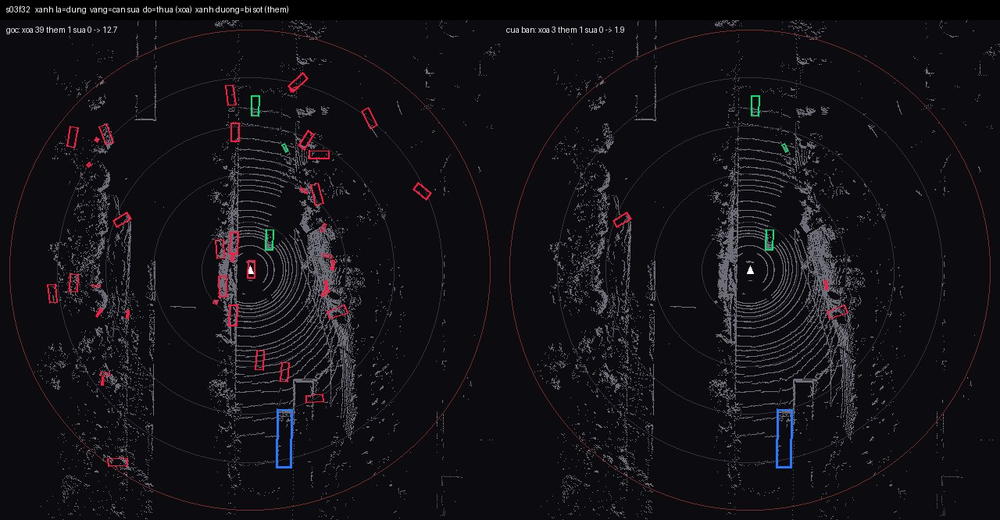

# Báo cáo Day 14 — Bạch Đặng Ngọc Tuấn — 2A202603314

- Mã học viên dùng với `--student`: `314`
- `seed_tag` trong `frames_A.txt`: `82ac3100fd`

## 1. Dự đoán trước sweep (bước 5b)

Ghi **trước** khi chạy `scripts/pp_sweep.py`, rồi commit và push ngay (lịch sử commit là bằng chứng thời điểm viết). Không sửa phần này sau khi có kết quả.

- Tham số tôi nghĩ giảm công sửa nhiều nhất: `score_thr = 0.4` và `min_points = 10`
- Vì sao (nhìn ảnh BEV tập A: box thừa nhiều hay box sót nhiều?): Ở cấu hình gốc (`score_thr = 0.1`, `min_points = 0`), tập A có quá nhiều box thừa (85 box phải xóa trên tổng 109 box, chiếm 25.5/28.5 tổng chi phí) trong khi chỉ sót 3 box. Tăng `score_thr` lên `0.4` và `min_points` lên `10` sẽ loại bỏ phần lớn box nhiễu/ít điểm có độ tin cậy thấp, giúp giảm mạnh công xóa mà vẫn giữ lại các vật thể thật rõ nét.

## 2. Tập A: sửa tay và tune

| Cấu hình | Xóa | Thêm | Sửa | Chi phí |
|---|---:|---:|---:|---:|
| Gốc | 85 | 3 | 0 | 28.5 |
| `best_config.json` | 14 | 4 | 0 | 8.2 |

- Tham số đã đổi trong `best_config.json`: `score_thr`: `0.1` → `0.5` (giữ `min_points`: `0`).
- Kết quả leave-one-out (dán các dòng `scripts/pp_sweep.py` in ra):
  ```text
  s03f32: cấu hình chọn {'score_thr': '0.5', 'min_points': '0'} → 1.9 (tốt nhất có thể 1.9)
  s04f04: cấu hình chọn {'score_thr': '0.5', 'min_points': '0'} → 2.2 (tốt nhất có thể 2.2)
  s05f37: cấu hình chọn {'score_thr': '0.5', 'min_points': '0'} → 4.1 (tốt nhất có thể 4.1)
  ```
- Cấu hình có ổn định trên từng frame không? Vì sao tôi vẫn chọn (hoặc không chọn) nó: Rất ổn định — trên cả 3 frame leave-one-out, cấu hình `score_thr = 0.5, min_points = 0` đều đạt đúng chi phí tối ưu nhất có thể (`1.9`, `2.2`, `4.1`). Tôi chọn cấu hình này cho tập B vì nó cắt giảm được 71 box thừa (từ 85 xuống 14) trong khi chỉ làm sót thêm 1 box.

## 3. Đối chiếu trước/sau (bước 8)



- `scripts/pp_compare.py` báo giảm **71%** công sửa trên tập A (tổng chi phí từ `28.5` xuống `8.2`).
- Dự đoán ở mục 1 đúng hay sai? Giải thích bằng số box xóa/thêm/sửa: Dự đoán ở mục 1 **đúng hướng** (tăng `score_thr` giúp giảm mạnh box thừa: cấu hình dự đoán `score_thr=0.4, min_points=10` đạt chi phí `12.4`, giảm hơn một nửa so với `28.5`), nhưng `pp_sweep.py` cho thấy `score_thr=0.5` còn tốt hơn nữa (`8.2`, xóa giảm từ 85 xuống 14, thêm chỉ tăng nhẹ từ 3 lên 4, sửa giữ 0).

## 4. Tập B

Số đo từ `scripts/pp_prelabel.py --frames d14_314/frames_B.txt --config d14_314/best_config.json --gt d14_314/ref_B.json`:

| Xóa | Thêm | Sửa | Chi phí |
|---:|---:|---:|---:|
| 43 | 21 | 6 | 36.9 |

- Loại box tốn công sửa nhất ở tập B: Các box bị sót phải **thêm mới** (`21` box × `1.0` = `21.0` điểm, chiếm hơn một nửa tổng chi phí `36.9`), đặc biệt là xe ở xa/bị che khuất hoặc xe bị lọc mất khi `score_thr = 0.5`; tiếp theo là các box nhiễu/false positive cần **xóa** (`43` box × `0.3` = `12.9` điểm).

## 5. Giới hạn

- **Giới hạn:** (1) Tập tune A chỉ có 3 frame nên tham số `score_thr = 0.5` có thể hơi chặt đối với một số frame đông/xa ở tập B (làm tăng số box cần thêm mới lên `21`); (2) Model PointPillars huấn luyện trên KITTI không có lớp `Truck`/`Bus` nên các xe tải/xe buýt lớn vẫn cần kiểm tra và đổi lớp hoặc chỉnh kích thước thủ công trên CVAT; (3) Công thức chi phí (`0.3·xóa + 1.0·thêm + 0.5·sửa`) chỉ là ước lượng tuyến tính, chưa phản ánh đúng thời gian thao tác thực tế khi xoay góc hay chỉnh độ cao Z trên CVAT.
